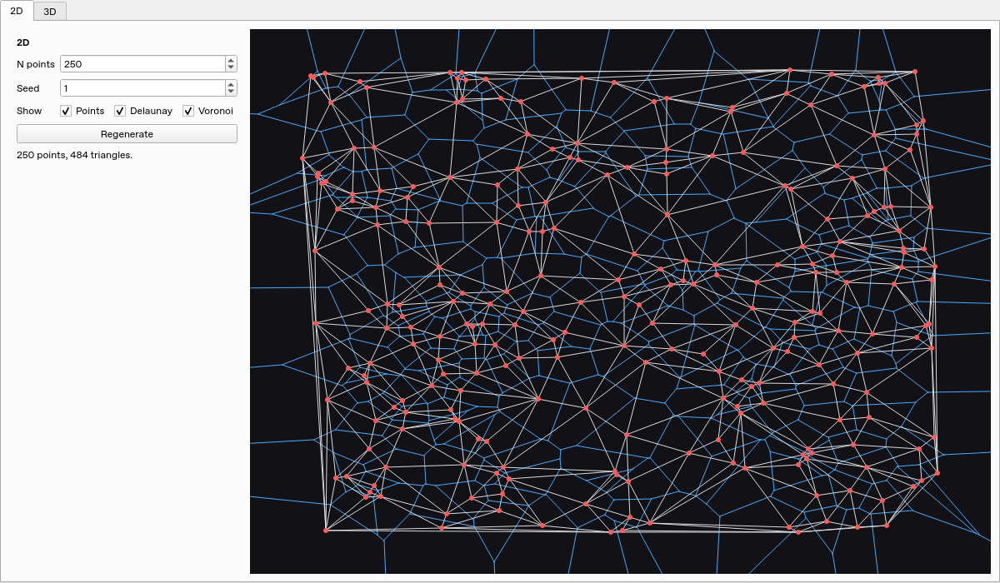
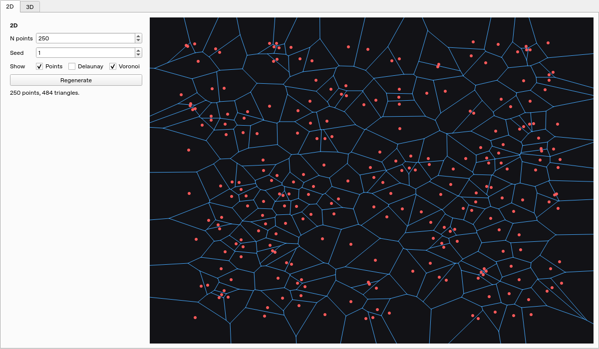
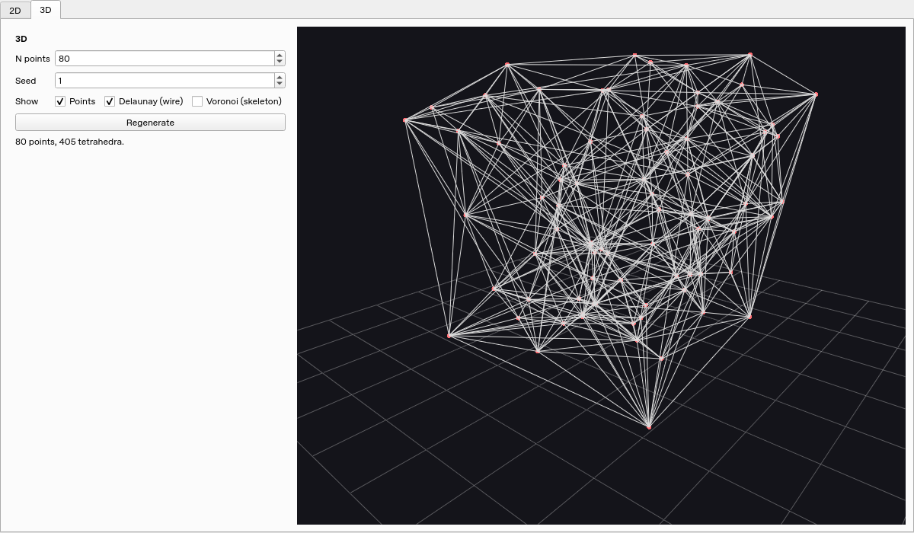
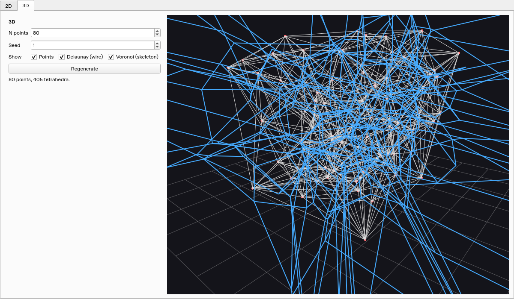

# Voronoi/Delaunay App

A learning-grade desktop app (PyQt6) that builds and visualizes:

- 2D Delaunay triangulation (Bowyer–Watson incremental)
- 2D Voronoi diagram (dual of Delaunay)
- 3D Delaunay tetrahedralization (Bowyer–Watson incremental)
- 3D Voronoi skeleton (dual graph)

## Screenshots

Captured from the running desktop app with seed **1** and the default point
counts. Red dots are input points, white lines are Delaunay edges, and blue lines
are Voronoi edges.

### 2D Delaunay and Voronoi

250 points with the triangulation and its dual diagram displayed together.



### 2D Voronoi

The same points with the Delaunay layer switched off using the display toggle.



### 3D Delaunay

80 points with the tetrahedralization shown as a wireframe. Drag the 3D view to
rotate it and scroll to zoom.



### 3D Delaunay and Voronoi skeleton

The same tetrahedralization with the blue Voronoi skeleton enabled. The skeleton
connects circumcenters across shared tetrahedron faces; it does not render full
Voronoi cells.



## Setup

```bash
python3 -m venv .venv
source .venv/bin/activate
pip install -r requirements.txt
```

## Run

```bash
python voronoi_delaunay_app.py
```

The triangulation builders start with a simplex formed from input points and
extend the convex hull as points are inserted. They rebuild the Delaunay conflict
cavity, including visible hull facets, without temporary enclosing vertices.
Predicates use normalized float64 coordinates; exact arithmetic for adversarial
near-degenerate inputs is still outside the scope of this learning app.

Both tabs generate points and triangulate in background threads. Generation
controls are disabled while a job runs, but display toggles and the existing
diagram remain usable. A status message reports completion or failure. Closing
the window requests cancellation and closes after the workers finish safely.

To refresh the README screenshots, run this from the repository root with the
project environment activated and a working desktop display with OpenGL support:

```bash
python scripts/capture_screenshots.py
```

The script opens the app, waits for background generation to finish, captures
both tabs and their display toggles, then closes the window. Images are saved in
`docs/images/`.

## Tests

With the project environment activated:

```bash
python -m unittest discover -s tests -v
```

The tests cover previously missing triangles/tetrahedra, independent convex-hull
area and volume checks, the empty-circle/sphere property, insertion order,
duplicate points, lower-dimensional and cospherical inputs, and 2D Voronoi
boundary rays from inside and outside the clipping box.
Offscreen Qt tests also check background generation, UI responsiveness, error
recovery, and cancellation during shutdown.
